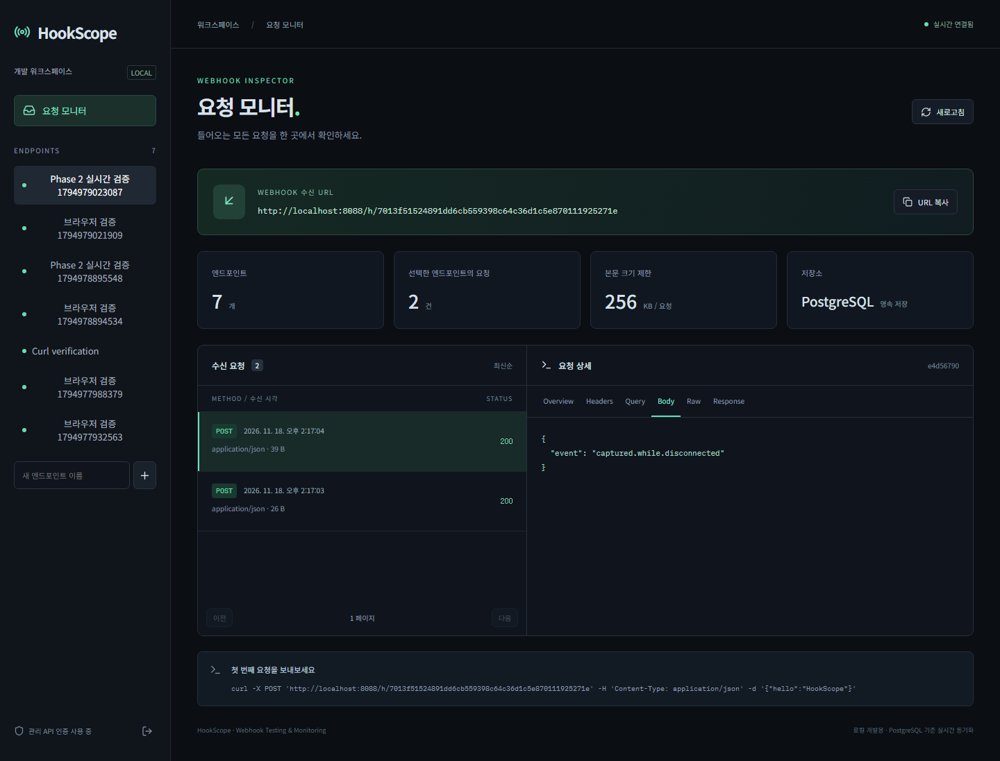
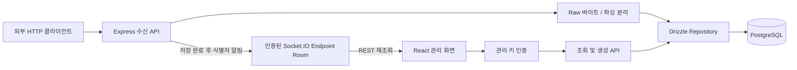

# HookScope

Webhook Testing & Monitoring Platform. 실제 HTTP 요청을 받아 PostgreSQL에 저장하고 헤더·쿼리·본문을 분석하는 한국어 개발 콘솔입니다.

현재 구현: **Phase 0–2**. 인증된 Socket.IO 실시간 모니터와 재연결 복구를 지원합니다. 검색/필터, Replay, 사용자 정의 응답, 통계 차트는 다음 단계입니다. 공개 데모 주소는 없습니다.



## 주요 기능
- 암호학적 난수로 고유 수신 URL 생성, 관리 키와 공개 토큰 분리
- GET / POST / PUT / PATCH / DELETE 수신
- JSON / Text / Form 파싱, 잘못된 JSON 오류 표시, Raw Body 바이트 보존
- 헤더 및 쿼리 중복값 보존, 인증 헤더 마스킹
- PostgreSQL 영속 저장, 최신순 30건 페이지 조회, 요청 상세 및 UTF-8 원문 미리보기
- 한국어 다크 관리 화면, URL 복사, 실시간 및 수동 갱신, 모바일 레이아웃
- 관리자 키로 인증된 Endpoint Room, Socket 상태 표시, 자동 재연결 및 REST 복구, 다중 탭 동기화
- 본문 크기 제한, 기본 Rate Limit, 준비 상태 확인, Docker Compose

## 스택 및 구조
로컬 검증 버전: Node.js 24.12.0, TypeScript 5.9.3, Express 5.3.0, Drizzle 0.45.4, pg 8.23.1, React 19.3.1, Vite 8.3.8, Zod 4.6.7, Pino 10.4.0, Vitest 5.1.0, Socket.IO/server-client 4.8.4, ESLint 10.15.0. 컨테이너 Node.js는 24.22.3. PostgreSQL 17 및 Redis 7 Alpine 이미지 사용. 정확한 JS 의존성은 package-lock.json으로 고정합니다.



수신 처리·파싱·영속화를 분리합니다. DB insert가 성공한 뒤에만 접수 응답을 반환합니다. Redis는 Compose에 준비되어 있으나 아직 수신 경로에 연결하지 않습니다.

## Docker 실행
Node.js 24.12 이상, Docker Desktop의 Linux 컨테이너 모드가 필요합니다. 프로젝트 루트에서 실행하세요.

```powershell
Copy-Item .env.example .env
# .env의 ADMIN_KEY를 임의의 충분히 긴 값(32자 이상)으로 교체
docker compose up -d --build
docker compose ps
```

[관리 화면](http://localhost:8088)을 열고 .env의 ADMIN_KEY를 입력하세요. 이번 작업 환경에는 임의의 키가 담긴 .env가 이미 생성되어 있습니다. 해당 파일은 Git 및 Docker 빌드에서 제외됩니다. API는 localhost:3000, DB는 localhost:5432입니다. 호스트 포트는 루프백에만 바인딩됩니다. 8080 포트가 기존 서비스에 사용되고 있어 프론트 기본값을 8088로 정했습니다. 변경 시 FRONTEND_PORT와 FRONTEND_ORIGIN을 함께 수정하세요.

DB 준비 후 API 시작 시 SQL 마이그레이션을 트랜잭션과 advisory lock 안에서 실행합니다. 서비스 healthcheck를 통해 기동과 준비 완료를 구분합니다. Named Volume에 DB가 유지됩니다.

```powershell
docker compose logs backend
docker compose stop
```

## Webhook 사용
1. 왼쪽 입력란에 이름을 입력하고 + 버튼으로 Endpoint를 생성합니다.
2. 수신 URL을 복사합니다.
3. 상단의 **실시간 연결됨** 상태를 확인하고 실제 요청을 전송합니다. 새로고침 없이 목록이 갱신됩니다.
4. 목록의 요청을 선택하여 Overview / Headers / Query / Body / Raw / Response를 확인합니다.

```bash
curl -X POST 'http://localhost:8088/h/YOUR_PUBLIC_TOKEN?tag=a&tag=b' \
  -H 'Content-Type: application/json' \
  -H 'X-Example: hello' \
  --data-binary '{"event":"payment.created","amount":1200}'
```

PowerShell에서는 curl.exe를 사용하고 JSON을 파일로 전송하면 셸 인용 문제를 피할 수 있습니다.

```powershell
curl.exe -X POST 'http://localhost:8088/h/YOUR_PUBLIC_TOKEN' -H 'Content-Type: application/json' --data-binary '@docs/curl-sample.json'
```

응답은 `200 {"requestId":"...","message":"Request recorded"}`이며 요청 기록의 접수 성공을 뜻합니다. 발신 시스템의 비즈니스 처리 성공을 의미하지 않습니다. DB 저장 실패는 503입니다.

## 로컬 소스 개발
```powershell
npm ci
docker compose up -d postgres redis
# .env의 DATABASE_URL을 확인하고 FRONTEND_ORIGIN을 http://localhost:5173으로 변경
node --env-file=.env node_modules/tsx/dist/cli.mjs backend/src/migrate.ts
npm run dev:api
# 다른 터미널
npm run dev:web
```

Vite는 /api, /h, /health와 /socket.io의 polling/WebSocket을 localhost:3000으로 프록시합니다. Compose API와 소스 API를 동시에 같은 포트로 실행하지 마세요.

## 실시간 동기화
Socket은 ADMIN_KEY를 handshake.auth로 보내고 서버에서 인증한 뒤 선택한 Endpoint의 Room에 가입합니다. UUID 및 Endpoint 존재를 검사하며 공개 수신 토큰으로 관리 연결을 만들 수 없습니다. 현재는 단일 로컬 관리자가 모든 Endpoint를 관리합니다.
DB 저장 후 `webhook:received` 이벤트에 endpointId/requestId/method/receivedAt만 담아 전송합니다. 브라우저는 본문을 이벤트에서 누적하지 않고 REST API의 현재 페이지로 목록과 건수를 갱신합니다. 최근 512개 ID의 중복 알림을 무시하고 짧은 시간의 이벤트를 합쳐 조회합니다.
최초 연결·재연결은 Room 가입 ack 이후 REST를 재조회하므로 연결이 끊긴 동안 저장된 요청도 복구됩니다. 두 탭은 독립적으로 동기화하며 Endpoint 변경·로그아웃 시 기존 연결과 리스너를 정리합니다. 상단에서 연결 중/실시간/재연결/오류 상태를 확인할 수 있고 수동 새로고침도 유지합니다.
이벤트는 best effort입니다. 알림 발행 실패가 이미 저장된 요청을 취소하지 않습니다. 연결 중 알림이 유실되면 수동 갱신·탭 복귀·다음 알림·재연결로 복구할 수 있습니다. Redis adapter, 분산 Room 및 영속 이벤트 큐는 아직 구현하지 않았습니다.

## API 및 테스트
관리 API에는 `Authorization: Bearer <ADMIN_KEY>`가 필요합니다. [API 계약](docs/openapi.yaml), [설계](PROJECT.md), [아키텍처](docs/ARCHITECTURE.md), [진행 기록](docs/PROGRESS.md), [결정 기록](docs/DECISIONS.md)을 참고하세요.

```powershell
npm run typecheck
npm run lint
npm test
npm run build
docker compose exec -T backend npm run smoke
npx playwright install chromium
npx playwright test --config frontend/playwright.config.ts
```

Vitest/Supertest 및 실제 Socket 클라이언트 테스트 26개는 인증·수신·실패 경계, Room 격리, 저장 후 발행, 중복 알림 처리를 검증합니다. Repository 더블 기반 테스트와 실제 PostgreSQL smoke를 구분합니다. smoke는 생성→HTTP 수신→SQL 원본 바이트 비교→인증된 Socket Room 알림 ID/시각 대조→목록·상세·인증을 검증하고 자신의 데이터를 정리합니다.
Compose 기반 Playwright 2개는 기존 수신 상세 흐름과 두 탭 자동 갱신, 실제 알림 프레임 중복, WebSocket 중단 후 누락 요청 복구, 모바일 로그아웃을 검증합니다. 실제 엔드포인트 및 테스트 요청을 남기며 화면 수치는 DB 데이터만 사용합니다. CI는 타입 검사, Lint, 테스트, 빌드, PostgreSQL migration 및 smoke를 실행합니다. 원격 CI 실행은 아직 미검증입니다.

## 보안·보관 정책 및 제약
- 로컬 단일 관리자 MVP입니다. ADMIN_KEY를 공유하면 같은 관리 권한을 갖습니다. 다중 사용자·소유권·로그인 세션은 미구현입니다.
- 수신 본문 256KiB, 관리 JSON 16KiB, URL 8KiB 제한. 압축 본문은 415. 수신 IP별 120회/분, 관리 IP별 300회/분이며 메모리 기반 단일 인스턴스용입니다.
- OPTIONS는 CORS 응답 204로 처리하며 저장하지 않습니다. HEAD와 그 외 메서드는 405입니다.
- Raw Body는 Base64로 저장합니다. UTF-8 화면은 미리보기이며 서명 검증에는 API 원본 바이트를 사용해야 합니다. multipart/binary는 파싱 없이 원본만 같은 제한으로 저장합니다.
- Authorization, Cookie, token/secret/API-key 계열 헤더는 저장 전에 마스킹합니다. Body·Query는 원문이 저장되므로 실제 자격 증명을 보내지 마세요. 요청 IP는 저장하지 않습니다.
- 자동 만료·삭제 UI·전체 저장 용량 제한은 후속 Phase입니다. 현재 데이터는 수동 DB 정리 전까지 보관됩니다. 데이터가 필요하면 Volume을 유지하세요.
- 전체 응답 소요시간은 아직 측정하지 않습니다. durationMs는 저장 전 캡처 준비 시간이며 responseStatus는 예정 응답입니다. 실제 전송 완료는 구조화 로그의 RESPONSE_SENT입니다.
- 검색 필터·JSON Tree·Light Mode·Custom Response·Test Sender·Replay 및 BullMQ Worker는 이번 범위에서 구현하지 않았습니다. 외부 URL 전송은 제공하지 않습니다.
- 배포된 서비스가 없습니다. 공개 운영에는 HTTPS, 계정별 권한, 수신/보관 한도, 정리 작업, 공유 Rate Limit을 추가해야 합니다.
- `npm audit --omit=dev`는 0건입니다. 전체 감사는 picomatch 및 연관 개발 도구의 High 11건을 보고합니다. 현재 로컬 backend 이미지는 테스트 실행을 위해 개발 의존성도 포함합니다. 강제 다운그레이드는 다른 보안 수정과 충돌하므로 적용하지 않았습니다. 상세 결과는 PROGRESS.md에 기록합니다.

스크린샷: [데스크톱](docs/screenshots/phase2-desktop.png) · [모바일](docs/screenshots/phase2-mobile.png). 다음 단계는 **Phase 3 요청 상세 분석 및 검색**입니다.
