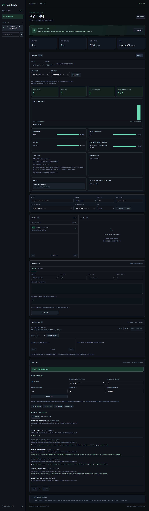
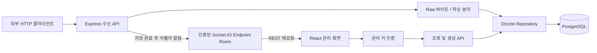

# HookScope

Webhook Testing & Monitoring Platform. 실제 HTTP 요청을 받아 PostgreSQL에 저장하고 헤더·쿼리·본문을 분석하는 한국어 개발 콘솔입니다.

현재 구현: **Phase 0–7**. 기존 수신·분석·Internal Replay·Analytics와 사용자별 접근 제어, 만료·보관·수신 한도 및 감사 이력을 지원합니다. 공개 데모 주소는 없습니다.



## 주요 기능
- 암호학적 난수로 고유 수신 URL 생성, 관리 키와 공개 토큰 분리
- GET / POST / PUT / PATCH / DELETE 수신
- JSON / Text / Form 파싱, 잘못된 JSON 오류 표시, Raw Body 바이트 보존
- 헤더 및 쿼리 중복값 보존, 인증 헤더 마스킹
- PostgreSQL 영속 저장, 최신순 30건 페이지 조회, 요청 상세 및 UTF-8 원문 미리보기
- 한국어 다크 관리 화면, URL 복사, 실시간 및 수동 갱신, 모바일 레이아웃
- 관리자 키로 인증된 Endpoint Room, Socket 상태 표시, 자동 재연결 및 REST 복구, 다중 탭 동기화
- 서버 키워드 검색, Method/Status/Content-Type/수신 기간 필터, 최신·오래된 순 정렬 및 30건 페이지
- 헤더 검색·복사, 중복 Query 행, JSON 트리·민감 필드 표시 마스킹, Text/Form 분석 및 원본 바이트 다운로드
- Endpoint별 응답 Status/Content-Type/Body/Header/지연 설정, 실제 HTTP Test Sender 및 TEST 이력·응답 스냅샷
- 자체 Endpoint Internal Replay, 멱등 작업 생성·대기 취소·상태 필터, PostgreSQL 시도 이력과 원본 비교
- 전체/Endpoint별 Analytics, 시간별 차트·Method 비율·예정 응답 Status 분포·최근 오류·처리시간 분석
- 관리자 발급 사용자 키·Endpoint 소유권, DB 수신/보관 한도·만료·정리·감사 이력
- 본문 크기 제한, Rate Limit, 준비 상태 확인, Docker Compose

## 스택 및 구조
로컬 검증 버전: Node.js 24.12.0, TypeScript 5.9.3, Express 5.3.0, Drizzle 0.45.4, pg 8.23.1, React 19.3.1, Vite 8.3.8, Zod 4.6.7, Pino 10.4.0, Vitest 5.1.0, Socket.IO/server-client 4.8.4, ESLint 10.15.0. 컨테이너 Node.js는 24.22.3. PostgreSQL 17 및 Redis 7 Alpine 이미지 사용. 정확한 JS 의존성은 package-lock.json으로 고정합니다.



수신 처리·파싱·영속화·알림·재전송을 분리합니다. DB insert가 성공한 뒤에만 접수 응답을 반환합니다. BullMQ 5.81.6과 별도 Worker가 재전송을 수행하며 Redis에는 작업 ID만 저장합니다. PostgreSQL이 작업/시도 이력의 기준이고 일반 수신은 Redis 장애와 독립적입니다.

## Docker 실행
Node.js 24.12 이상, Docker Desktop의 Linux 컨테이너 모드가 필요합니다. 프로젝트 루트에서 실행하세요.

```powershell
Copy-Item .env.example .env
# .env의 ADMIN_KEY를 임의의 충분히 긴 값(32자 이상)으로 교체
docker compose up -d --build
docker compose ps
```

[관리 화면](http://localhost:8088)을 열고 .env의 ADMIN_KEY를 입력하세요. 이번 작업 환경에는 임의의 키가 담긴 .env가 이미 생성되어 있습니다. 해당 파일은 Git 및 Docker 빌드에서 제외됩니다. API는 localhost:3000, DB는 localhost:5432입니다. 호스트 포트는 루프백에만 바인딩됩니다. 8080 포트가 기존 서비스에 사용되고 있어 프론트 기본값을 8088로 정했습니다. 변경 시 FRONTEND_PORT와 FRONTEND_ORIGIN을 함께 수정하세요.

DB 준비 후 API 시작 시 SQL 마이그레이션을 트랜잭션과 advisory lock 안에서 실행하고 schema_migrations에 기록합니다. 기존 DB도 0002–0006의 테이블·컬럼·인덱스를 자동 추가하며 데이터를 삭제하지 않습니다. frontend/backend/worker/postgres/redis 다섯 서비스의 healthcheck로 준비 상태를 확인합니다. Worker는 DB 확인 후 Redis heartbeat를 갱신합니다. Named Volume에 DB가 유지됩니다. Redis는 소스 개발용으로 localhost:6379에만 바인딩합니다.

```powershell
docker compose logs backend
docker compose stop
```

## Webhook 사용
1. 왼쪽 입력란에 이름을 입력하고 + 버튼으로 Endpoint를 생성합니다.
2. 수신 URL을 복사합니다.
3. 상단의 **실시간 연결됨** 상태를 확인하고 실제 요청을 전송합니다. 새로고침 없이 목록이 갱신됩니다.
4. 목록의 요청을 선택하여 Overview / Headers / Query / Body / Raw / Response를 확인합니다.

## 요청 검색 및 상세 분석
상단에 키워드·Method·응답 상태·Content-Type·수신 시작/종료·정렬을 입력하고 **검색 적용**을 누릅니다. **초기화**는 조건을 지우며 두 동작 모두 첫 페이지로 이동합니다. 적용된 조건과 현재 페이지는 실시간 알림·재연결 뒤에도 유지됩니다. 건수는 필터에 맞는 요청 수입니다.

- 키워드: Request ID, Parsed Body, 마스킹된 Headers, Query, Content-Type에서 대소문자를 구분하지 않는 부분 문자열을 찾습니다. 최대 200자이며 `%`, `_`도 문자 그대로 검색합니다. 파싱 실패한 원문과 binary/Base64 본문은 검색하지 않습니다.
- Content-Type: `application/json`처럼 미디어 타입만 입력합니다. 저장된 charset/boundary 매개변수와 대소문자는 비교에서 제외합니다.
- 수신 기간: 현지 시각을 입력하면 UTC로 전송합니다. 양쪽 경계를 포함하며 시작이 종료보다 늦으면 거부합니다.
- 목록·건수: PostgreSQL의 같은 읽기 스냅샷에서 조회합니다. 같은 시각의 요청은 UUID로 순서를 고정합니다. 실시간 수신에 따라 offset 페이지의 내용이 이동할 수 있습니다.
- Headers/Query: 헤더 이름·값 검색과 개별/전체 복사, 중복 Query 값별 행을 제공합니다.
- Body: JSON 보기/펼칠 수 있는 트리, Text/Form, Binary 메타데이터를 제공합니다. JSON 민감 키는 표시·복사 시 기본 마스킹하며 해제할 수 있습니다. 저장 및 검색 데이터는 변경하지 않습니다.
- Raw: 텍스트는 UTF-8 미리보기, binary/multipart는 Base64로 표시합니다. **원본 다운로드**는 모든 형식에서 수신 바이트 그대로 `.bin` 파일을 저장합니다. Raw와 다운로드에는 민감값도 원문으로 포함될 수 있습니다.

관리 API 예시: `GET /api/v1/endpoints/:id/requests?page=1&method=POST&contentType=application%2Fjson&q=payment&sort=newest`. 상세 query 계약은 [OpenAPI](docs/openapi.yaml)와 [PROJECT.md](PROJECT.md)를 참고하세요.

```bash
curl -X POST 'http://localhost:8088/h/YOUR_PUBLIC_TOKEN?tag=a&tag=b' \
  -H 'Content-Type: application/json' \
  -H 'X-Example: hello' \
  --data-binary '{"event":"payment.created","amount":1200}'
```

PowerShell에서는 curl.exe를 사용하고 JSON을 파일로 전송하면 셸 인용 문제를 피할 수 있습니다.

```powershell
curl.exe -X POST 'http://localhost:8088/h/YOUR_PUBLIC_TOKEN' -H 'Content-Type: application/json' --data-binary '@docs/curl-sample.json'
```

기본 응답은 `200 {"requestId":"...","message":"Request recorded"}`이며 요청 기록의 접수 성공을 뜻합니다. 발신 시스템의 비즈니스 처리 성공을 의미하지 않습니다. DB 저장 실패는 503입니다.

## 응답 설정 및 Test Sender
선택한 Endpoint의 **Endpoint 도구 → 응답 설정**에서 사용자 정의 모드를 선택하고 저장합니다. 이후 수신하는 요청에 적용하며 과거 요청의 응답 스냅샷은 바꾸지 않습니다. 기본 모드로 저장하면 기존 200 접수 JSON을 사용합니다.

- Status 200–599, Content-Type JSON/Text, UTF-8 Body 최대 8KiB, 지연 0–2000ms를 지원합니다. 지연은 비동기이며 다른 요청의 이벤트 루프를 막지 않습니다.
- 204·205·304는 Body를 비워야 합니다. JSON Body는 오류 재현을 위해 문법이 잘못된 문자열도 허용합니다.
- Header는 `[["X-Test-Result","ok"]]` 형태입니다. X-Test-/X-Mock-/X-Custom-만 최대 12쌍 허용하고, 값은 ASCII 512자 이하입니다. 중복 이름·CRLF·Location·Cookie·보안/연결 Header 변경은 거부합니다.
- 저장된 Response 탭은 수신 시점의 응답 계획입니다. 실제 클라이언트 수신 완료를 보증하지 않으며 Date/프록시 Header 전체를 보관하지 않습니다. 기존 기록에 스냅샷이 없으면 없다고 표시합니다.

**테스트 전송** 탭에서는 읽기 전용 자체 URL, Method, Content-Type, Header/Query 쌍과 Body를 설정하고 실제 HTTP 요청을 보냅니다. Header/Query는 배열의 쌍으로 입력하므로 중복 Query도 유지됩니다. Body는 JSON/Text/Form UTF-8 8KiB까지, GET은 빈 Body만 허용합니다. Request Header는 위 X- 접두사와 Accept/User-Agent만 지원합니다. 관리 JSON 전체 16KiB 제한도 적용됩니다.

전송 결과에서 실제 HTTP 응답·걸린 시간·DB 저장 확인을 보고 **수신 요청 상세 열기**로 이동할 수 있습니다. 테스트 수신 기록에는 `TEST` 배지가 붙습니다. 422 같은 사용자 정의 오류 응답도 정상적으로 기록될 수 있으므로 HTTP 상태와 저장 확인을 구분하세요. 테스트 API의 200은 실행 결과를 반환했다는 의미입니다.

서버는 자신의 숫자 루프백 주소와 실제 listening port의 고정 경로로만 요청합니다. 사용자 URL·관리 Authorization·Cookie를 전달하지 않으며 redirect를 따라가지 않습니다. 전송 전체 5초, 응답 Body/Header 각 16KiB, 동시 8개, 관리 IP별 분당 20회를 제한하고 자동 재시도하지 않습니다. TIMEOUT/FAILED 또는 미확인 저장은 결과에 표시하며 늦게 저장된 요청은 목록에서 추가 확인할 수 있습니다.

내부 일회용 식별자는 서버에서 Endpoint/Request ID와 결합해 한 번만 소비하므로 외부 요청이 Header를 흉내 내어 TEST 출처를 만들 수 없습니다. 내부 토큰은 이력에서 제외합니다. Test Sender 자체의 실패 감사와 설정 변경 감사 이력은 아직 제공하지 않습니다. 다음 Replay 기능은 별도 작업/시도 이력을 남깁니다.

## Internal Replay
수신 목록에서 원본을 선택한 뒤 **Replay Center → Internal Replay 실행**을 누릅니다. 최대 시도 1–3회를 선택하고 작업 상태·실제 관측 응답·시도별 수신 상세와 원본 Parsed Body를 비교할 수 있습니다. 생성 시 UUID 멱등 키를 사용하며 네트워크 오류로 생성 응답을 잃으면 같은 키로 다시 조회합니다. 의도적인 새 실행은 새 작업입니다. 상태는 활성 탭에서 2초마다 갱신하며 대기 작업만 취소할 수 있습니다.

Worker는 원본의 같은 Endpoint로 Raw Body 바이트와 중복 Query를 전송합니다. 인증/쿠키/연결 Header는 제외하고 허용된 테스트 Header만 전달합니다. 외부 URL 입력과 redirect 추적은 제공하지 않습니다. HMAC 증명과 활성 DB 시도를 함께 확인하여 `REPLAY` 출처를 부여하고 동일 시도는 한 수신 기록에 연결합니다.

2xx는 성공, 429/5xx는 1초·2초 백오프로 제한 재시도하고 다른 응답은 실패로 종료합니다. 전송 결과가 불확실하거나 실행 중 중단된 경우 `UNKNOWN`으로 종료하여 자동 재전송하지 않습니다. timeout 5초, 응답 Header/Body 각각 16KiB 제한입니다. 원본의 예정 응답 스냅샷과 Worker의 실제 HTTP 관측 결과는 구분됩니다.

Redis enqueue 실패에도 PostgreSQL의 PENDING을 유지하고 5초 주기 조정자가 복구합니다. 재등록 후에도 DB의 재시도 시각을 지킵니다. 작업 ID만 Redis에 저장하며 모든 장애 상황에서 exactly-once 전달을 보장하지 않습니다.

## Analytics 및 모니터링
**Analytics → 분석 범위**에서 선택한 Endpoint 또는 전체 Dashboard를 고릅니다. 최근 24시간/7일 또는 현지 시각으로 최대 31일을 조회할 수 있습니다. 요청 검색 조건과는 독립적이며 활성 탭에서 15초마다 조회합니다. **통계 갱신**으로 직접 갱신할 수도 있습니다.

- 보관된 전체 요청과 기간 내 수신·최근 1시간 건수를 구분합니다. EXTERNAL/TEST/REPLAY 모두 포함합니다.
- UTC 시간별 차트와 펼칠 수 있는 수치 표, Method 비율, 예정 응답 Status·출처 분포, Endpoint 상위 10개 수신량을 제공합니다. 시작 시각 포함·종료 시각 미포함이며 빈 시간은 0건입니다.
- 최근 수신/오류 각각 5건에서 실제 요청 상세로 이동합니다. 예정 4xx·5xx와 파싱 오류는 별도 집계하며 한 요청이 양쪽에 포함될 수 있습니다.
- 캡처 준비 평균/P95는 DB 저장 전 시간이며 전체 응답 시간이 아닙니다. Replay의 실제 HTTP 평균/P95와 측정된 시도 수는 별도로 표시합니다. 측정값이 없으면 **측정 없음**입니다. 예정 오류 응답은 대상 업무 실패율을 뜻하지 않습니다.
- 집계는 PostgreSQL의 같은 읽기 스냅샷을 사용합니다. 수신 본문·Header·Query·공개 토큰을 통계 응답에 포함하지 않습니다. 조회 실패는 오류로 표시하며 가짜 0건으로 대체하지 않습니다.

API: `GET /api/v1/dashboard/summary`, `GET /api/v1/endpoints/:id/statistics`. 선택 query는 시간대가 포함된 ISO `from`/`to`이며 기본값은 최근 24시간입니다. Endpoint 수와 보관 전체 건수 외의 값은 선택 기간 기준입니다. Replay 시간은 시도 시작 시각 기준입니다. 상세 계약은 [PROJECT.md](PROJECT.md)와 [OpenAPI](docs/openapi.yaml)를 참고하세요.

## 사용자별 보안 및 운영
기존 `.env`의 ADMIN_KEY로 로그인하면 전체 관리자입니다. **보안 및 운영 → 사용자 관리**에서 이름을 입력해 사용자 키를 발급하세요. 키는 한 번만 표시되며 SHA-256 해시만 DB에 저장하고 30일 후 만료됩니다. 사용자도 같은 로그인 화면을 사용하며 본인 Endpoint·수신·Replay·통계·감사만 조회/변경할 수 있습니다. 재발급은 이전 키를 폐기하고 비활성화는 API·Socket·소유 Endpoint 수신을 막습니다. 키 만료만으로 공개 수신이 중지되지는 않습니다.

**Endpoint 운영 정책**에서 수신 활성화·만료 시각, 보관 일수, 분당 수신 수, 최대 요청 수와 원본 Body 합계 한도를 설정합니다. 사용자당 Endpoint 20개, 관리자 1000개이며 Endpoint 기본 한도는 분당 120건·보관 10000건·Body 합계 64MiB입니다. Endpoint별 Replay 작업도 최대 1000개로 제한하며 기존 멱등 키 재조회는 허용합니다. IP별 제한도 함께 적용됩니다. 한도를 낮춰도 기존 기록을 임의 삭제하지 않고 다음 수신부터 제한합니다.

신규 Endpoint는 기본 7일 보관이고 기존 Endpoint는 수동 보관을 유지합니다. 60초마다 최대 20개 Endpoint에서 각 100개 만료 요청을 정리합니다. Replay 원본/시도와 연결된 수신은 pin되어 남으며 **요청 이력 삭제**에서 종료 Job/Attempt와 함께 정리합니다. 미완료 Replay가 있으면 전체 이력/Endpoint 삭제는 409입니다. 먼저 작업을 취소하거나 종료를 기다리세요. URL 재발급 후 이전 토큰으로 새로 승인되는 요청은 거부됩니다.

감사 조회는 정책·설정·Replay·삭제·정리 등의 metadata를 30건씩 제공합니다. 본문·키/해시·공개 토큰은 포함하지 않습니다. 감사는 90일 보관하며 DB 관리자에 의한 변조 방지까지 보장하지 않습니다. 운영자가 직접 정리 배치를 실행할 때는 아래 명령을 사용합니다.

```powershell
docker compose exec -T backend npm run cleanup
# 소스 환경
node --env-file=.env node_modules/tsx/dist/cli.mjs backend/src/cleanup.ts
```

실제 공개 배포에서 추가 확인할 사항은 [SECURITY.md](docs/SECURITY.md)를 참고하세요.

## 로컬 소스 개발 명령
```powershell
npm ci
docker compose up -d postgres redis
# .env의 DATABASE_URL을 확인하고 FRONTEND_ORIGIN을 http://localhost:5173으로 변경
node --env-file=.env node_modules/tsx/dist/cli.mjs backend/src/migrate.ts
npm run dev:api
# 다른 터미널
npm run worker -w backend
# 다른 터미널
npm run dev:web
```

Vite는 /api, /h, /health와 /socket.io의 polling/WebSocket을 localhost:3000으로 프록시합니다. Compose API와 소스 API를 동시에 같은 포트로 실행하지 마세요.

## 실시간 동기화
Socket은 ADMIN_KEY를 handshake.auth로 보내고 서버에서 인증한 뒤 선택한 Endpoint의 Room에 가입합니다. UUID 및 Endpoint 존재를 검사하며 공개 수신 토큰으로 관리 연결을 만들 수 없습니다. ADMIN_KEY 관리자는 모든 Endpoint를 관리하고 사용자 키는 자기 Endpoint만 관리합니다. Socket 구독과 이벤트 전달에서도 같은 범위를 검사합니다.
DB 저장 후 `webhook:received` 이벤트에 endpointId/requestId/method/receivedAt만 담아 전송합니다. 브라우저는 본문을 이벤트에서 누적하지 않고 REST API의 현재 페이지로 목록과 건수를 갱신합니다. 최근 512개 ID의 중복 알림을 무시하고 짧은 시간의 이벤트를 합쳐 조회합니다.
최초 연결·재연결은 Room 가입 ack 이후 REST를 재조회하므로 연결이 끊긴 동안 저장된 요청도 복구됩니다. 두 탭은 독립적으로 동기화하며 Endpoint 변경·로그아웃 시 기존 연결과 리스너를 정리합니다. 상단에서 연결 중/실시간/재연결/오류 상태를 확인할 수 있고 수동 새로고침도 유지합니다.
이벤트는 best effort입니다. 알림 발행 실패가 이미 저장된 요청을 취소하지 않습니다. 연결 중 알림이 유실되면 수동 갱신·탭 복귀·다음 알림·재연결로 복구할 수 있습니다. Redis adapter, 분산 Room 및 영속 이벤트 큐는 아직 구현하지 않았습니다.

## API 및 테스트
관리 API에는 `Authorization: Bearer <ADMIN_KEY 또는 사용자 키>`가 필요합니다. [API 계약](docs/openapi.yaml), [설계](PROJECT.md), [아키텍처](docs/ARCHITECTURE.md), [진행 기록](docs/PROGRESS.md), [결정 기록](docs/DECISIONS.md)을 참고하세요.

```powershell
npm run typecheck
npm run lint
npm test
npm run build
docker compose exec -T backend npm run smoke
docker compose exec -T backend npm run smoke:filters
docker compose exec -T backend npm run smoke:response
docker compose exec -T backend npm run smoke:replay
docker compose exec -T backend npm run smoke:analytics
docker compose exec -T backend npm run smoke:security
npx playwright install chromium
npx playwright test --config frontend/playwright.config.ts
```

Vitest/Supertest 및 실제 Socket/HTTP 클라이언트 테스트 **168개**가 통과했습니다. Repository 더블 검증과 실제 PostgreSQL 검증을 구분합니다. 실제 Compose smoke 6종은 기존 수신·필터·응답 설정·Replay와 신규 Analytics를 확인합니다. Analytics는 실제 HTTP 수신 후 DB에 명시적 시각/상태/시도 fixture를 설정하여 UTC·offset·부분 시간·종료 경계, Endpoint 격리, P95, 빈 값, 원문 미노출을 확인합니다. Security smoke는 키 해시·만료·폐기, 사용자별 REST/Socket/Replay/통계 격리, 동시 수신/보관 한도, pin 보존과 감사 metadata도 검증합니다. 각 smoke는 자신의 데이터를 정리합니다.
Compose 기반 Playwright **9개**는 기존 8개 회귀와 사용자 콘솔의 키 발급·소유권·운영 정책·만료·URL 재발급·삭제·감사 및 데스크톱/모바일 넘침을 확인합니다. 운영 한도를 유지하면서 남은 RateLimit이 부족하면 테스트 fixture가 다음 창을 기다립니다. E2E는 실제 Endpoint와 테스트 요청을 남기며 화면 수치는 DB 데이터만 사용합니다. Phase 7 소유권 migration 전후 Endpoint **87개**, 요청 **520건**, Replay 작업 **12건**, 시도 **17건**과 원문/파싱 지문이 일치했습니다. 기존 87개 Endpoint의 수동 보관도 유지했습니다. CI에 Security smoke를 추가했으며 원격 CI 실행은 미검증입니다. 과거 Phase의 검증은 [진행 기록](docs/PROGRESS.md)에 유지합니다.

## 보안·보관 정책 및 제약
- 관리자가 발급하는 사용자 키와 소유권을 지원합니다. ADMIN_KEY 공유자는 전체 관리 권한을 갖습니다. 공개 가입·비밀번호·SSO·쿠키 세션은 제공하지 않습니다.
- 수신 본문 256KiB, 관리 JSON 16KiB, URL 8KiB 제한. 압축 본문은 415. 수신 IP별 120회/분, 관리 IP별 300회/분이며 메모리 기반 단일 인스턴스용입니다.
- OPTIONS는 CORS 응답 204로 처리하며 저장하지 않습니다. HEAD와 그 외 메서드는 405입니다.
- Raw Body는 Base64로 저장합니다. UTF-8 화면은 미리보기이며 서명 검증에는 API 원본 바이트를 사용해야 합니다. multipart/binary는 파싱 없이 원본만 같은 제한으로 저장합니다.
- Authorization, Cookie, token/secret/API-key 계열 헤더는 저장 전에 마스킹합니다. Body·Query는 원문이 저장되므로 실제 자격 증명을 보내지 마세요. 요청 IP는 저장하지 않습니다.
- Endpoint 만료·삭제 UI·요청/원본 Body 보관 한도를 지원합니다. 기존 Endpoint는 수동 보관, 신규 기본 보관은 7일입니다. Replay 참조는 자동 정리에서 보존되므로 보관 기간을 넘겨 남을 수 있습니다. Body 합계 한도는 전체 DB 디스크 용량 한도가 아닙니다.
- 전체 응답 소요시간은 아직 측정하지 않습니다. durationMs는 저장 전 캡처 준비 시간이며 responseStatus는 예정 응답입니다. 실제 전송 완료는 구조화 로그의 RESPONSE_SENT입니다.
- Light Mode·외부 URL 전송은 제공하지 않습니다. 모든 프로세스 강제 종료·부하·멀티 인스턴스 장애 조합은 미검증입니다.
- Analytics는 읽기 시점 집계이며 전체 보관 건수도 DB에서 계산합니다. 대규모 장기 집계 부하는 미검증이며 캐시·사전 집계·전체 wire 응답시간 수집은 제공하지 않습니다.
- 키워드 검색은 Endpoint 범위의 텍스트 스캔입니다. 대량 검색·부하 성능은 미검증이며 JSON 트리는 분기당 100개씩, 최대 32단계까지만 펼칩니다. 마스킹은 키 이름 휴리스틱이며 비밀정보의 완전한 탐지를 보장하지 않습니다.
- 배포된 서비스가 없습니다. 실제 HTTPS·운영 프록시·공유 Rate Limit·디스크/백업 복구 등은 [공개 배포 점검](docs/SECURITY.md)을 따라 별도 검증해야 합니다.
- 2026-11-27 실행한 `npm audit` 및 `npm audit --omit=dev`는 모두 0건입니다. Phase 7은 새 의존성을 추가하지 않았으며 Compose의 npm ci도 0건을 보고했습니다. 로컬 backend 이미지는 테스트 실행을 위해 개발 의존성도 포함합니다.

스크린샷: [데스크톱](docs/screenshots/phase7-desktop.png) · [모바일](docs/screenshots/phase7-mobile.png). 다음 단계는 **Phase 8 UI/UX 및 성능**입니다.
